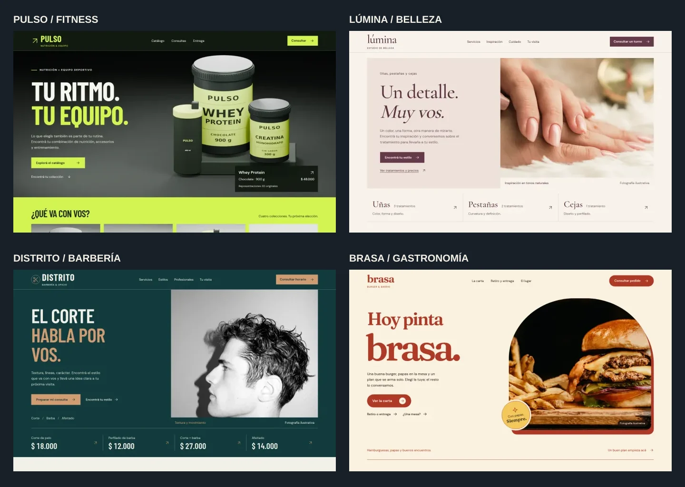

# Hola, soy Rafael

**Mi foco es pensar un producto con vos y llevar una versión concreta a producción, con ayuda de IA.**

Soy Rafael, de Argentina. Trabajo en webs, catálogos y herramientas para negocios. Me interesa entender qué necesita la persona que va a usarlos, definir un alcance posible y recorrer el camino hasta una entrega que se pueda abrir, usar y revisar.

Estoy en **etapa trainee en lo técnico**. Desarrollo con asistencia de IA, leo documentación y resuelvo problemas durante el proceso. Mi forma de avanzar es repetir entregas completas y llevarme aprendizaje de cada una.

[Web y demos](https://rafacreadigital.com.ar/) · [LinkedIn](https://www.linkedin.com/in/juanrafaelromero/) · [Instagram de Rafa Crea](https://www.instagram.com/rafacreadigital/)

## Entrega publicada · Rafa Crea

Landings, catálogos y sitios adaptados a cada marca, con diseño responsive y consultas por WhatsApp. El sitio reúne cuatro demos que se pueden recorrer en el navegador.

| Demo | Qué podés explorar |
| --- | --- |
| [PULSO · Fitness](https://rafacreadigital.com.ar/fitness/) | Catálogo con búsqueda, filtros, variantes y consultas por producto. |
| [Lúmina · Belleza](https://rafacreadigital.com.ar/belleza/) | Tratamientos, servicios y productos de cuidado personal. |
| [Distrito · Barbería](https://rafacreadigital.com.ar/barberia/) | Servicios, estilos y elección de profesional para preparar una consulta. |
| [Brasa · Gastronomía](https://rafacreadigital.com.ar/gastronomia/) | Carta por categorías y consultas por retiro, entrega o mesa. |

**Herramientas utilizadas:** Astro · TypeScript · Tailwind CSS · Cloudflare Pages.

[Leer el caso: necesidad, alcance y entrega](docs/rafa-crea.md).

Las demos representan negocios ficticios. Preparan consultas; la disponibilidad, los pagos y las reservas se coordinan con el negocio.

## Demo de aprendizaje · Sales Lead Assistant

[**Ver repositorio →**](https://github.com/RafaDev-Code/sales-lead-assistant)

Demo que analiza mensajes predefinidos de potenciales clientes, muestra un brief comercial en JSON y propone respuestas contextuales en español.

- Backend con **Python y FastAPI**; interfaz con **HTML, CSS y JavaScript**.
- Respuestas y estilos disponibles según el mensaje seleccionado.
- Modo de demostración sin claves; integración opcional con **OpenAI**.

## Cómo quiero construir cada entrega

1. **Entender el problema:** para quién es el producto y qué necesita resolver.
2. **Definir una primera versión:** recorrido principal, alcance y límites claros.
3. **Construir con IA y documentación:** probar, revisar errores y ajustar.
4. **Publicar y entregar:** dejar una versión usable, instrucciones y pendientes explícitos.
5. **Aprender del cierre:** registrar qué entendí, qué necesito profundizar y qué mejoraría en el próximo producto.

[Plantilla que uso para cerrar una etapa](docs/plantilla-entrega.md).

## Contacto

Para conversar sobre una web o un catálogo, podés ver mi trabajo en [Rafa Crea](https://rafacreadigital.com.ar/) y escribirme por [Instagram](https://www.instagram.com/rafacreadigital/). Para conectar por desarrollo y proyectos, estoy en [LinkedIn](https://www.linkedin.com/in/juanrafaelromero/).
